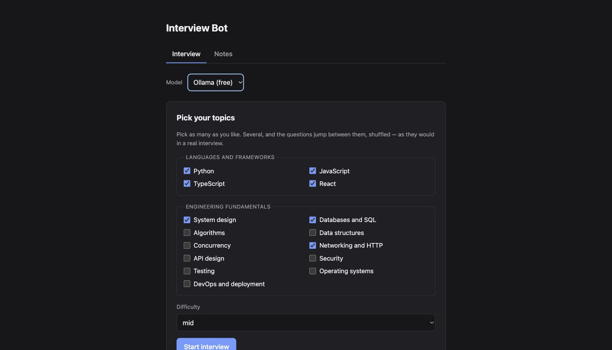
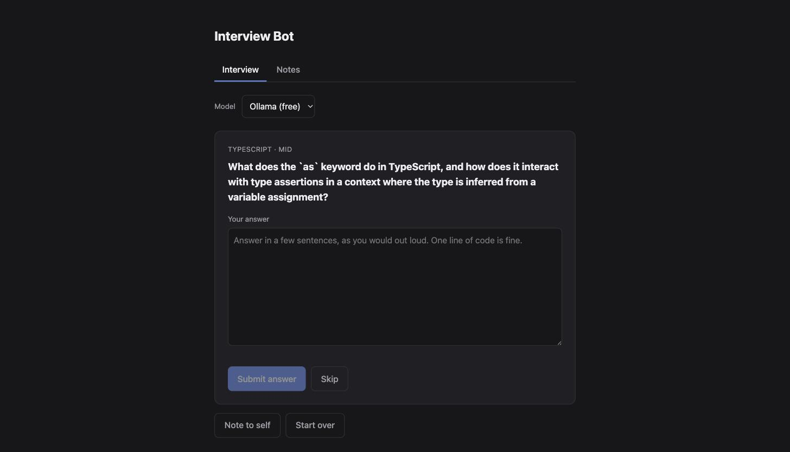
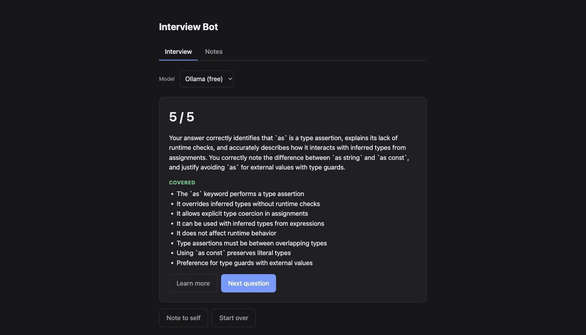
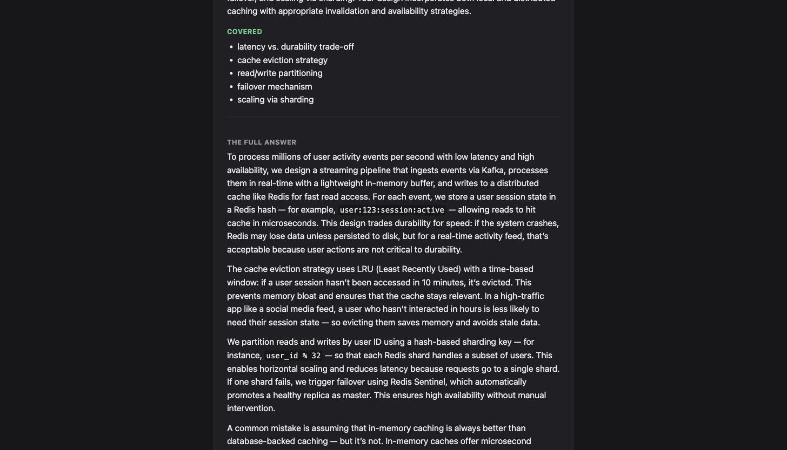
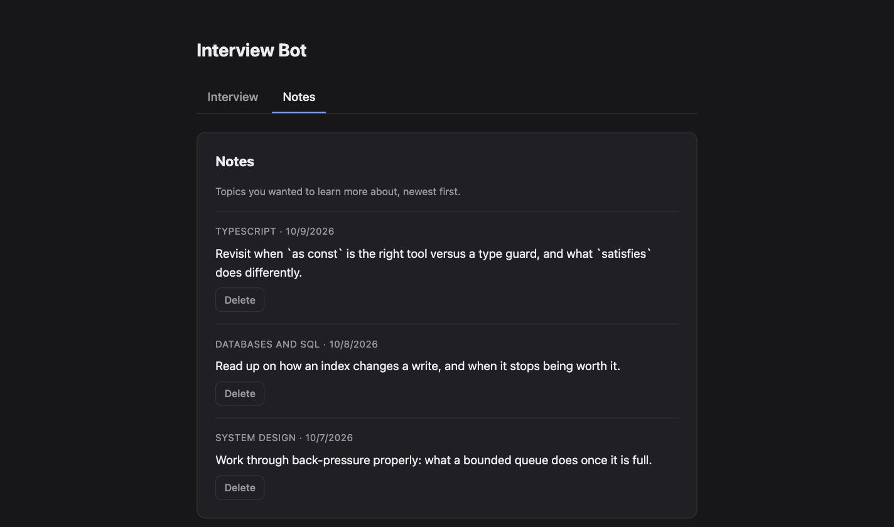

# interview-bot

A local chatbot for practising software engineering interview questions —
languages and frameworks as well as engineering fundamentals such as system
design, databases, algorithms and data structures. Tick several topics and the
questions jump between them, shuffled, the way a real interview does. Answers
are graded by a model — either one running on your own machine, or a hosted Claude model if
you would rather have the speed.

## Screenshots

Tick the topics you want, and how hard the questions should be. Several topics
and the interview moves between them, shuffled.



A question comes tagged with the topic it came from, so a mixed interview still
says what it is asking about.



Answers are graded out of five, against the key points the question was written
around — what you covered, and what you missed.



**Learn more** writes the answer out in full, so you can learn the question
without going off to search for it. It is written in the background while you
are still reading and typing.



**Note to self** keeps a topic to come back to, and the notes collect under
their own tab.



## Requirements

- [uv](https://docs.astral.sh/uv/getting-started/installation/)
- [Ollama](https://ollama.com/download), unless you run against a hosted model
- Node 20 or newer, with npm 11 or newer

## Setup

Install the backend dependencies:

```sh
cd backend
uv sync --all-groups
```

Install the frontend dependencies:

```sh
cd frontend
npm install
```

Start Ollama and pull a model:

```sh
ollama serve
ollama pull qwen3:4b-instruct
```

Or skip Ollama and use a hosted model instead — see [Running against a hosted
model](#running-against-a-hosted-model).

## Run

The app needs both halves running, in two terminals.

Backend:

```sh
cd backend
uv run uvicorn interview_bot.main:app --reload
```

Frontend:

```sh
cd frontend
npm run dev
```

Open http://localhost:5173 and tick the topics you want. The API is on
http://localhost:8000, with interactive docs on http://localhost:8000/docs.

Ticking more than one topic makes it a mixed interview: each question comes
from one of them, shuffled, and the tag above the question says which — see
[Mixed topics](#mixed-topics).

A **Model** dropdown above the topics sits over the whole interview. It starts
on **Ollama (free)**, the model on your own machine, and switching it to
**Claude** moves the interview onto the hosted model from the next question
onwards — see [Running against a hosted model](#running-against-a-hosted-model)
for what that needs and what it costs.

**Skip**, under the answer box, passes on a question you already know without
answering it. Nothing is graded, and the question does not come round again —
each new question is asked to avoid the ones already put up.

A grade comes with a **Learn more** button. It writes the answer out in full —
a few paragraphs, every key point expanded, and the mistakes people usually
make — so you can learn the question without going off to search for it. It
only appears once you have answered, and it folds away again with **Hide
details**.

The worked answer is written in the background while you are reading the
question and typing, so by the time you click there is usually nothing left to
wait for.

**Note to self** opens a box to jot down a topic you want to learn properly
later, and the notes pile up under the **Notes** tab — see [Notes](#notes).

Refreshing the page picks the interview back up where you left it. Use
**Start over** to drop it and choose different topics.

On the local model, expect each question and each grade to take a few
seconds, and a worked answer to take longer — it is several times as much
writing. A hosted model is quicker on all three.

Check the backend came up:

```sh
curl http://localhost:8000/health
```

## Tests

Backend:

```sh
cd backend
uv run pytest
uv run ruff check .
uv run ruff format .
```

The Postgres store's tests run only when `INTERVIEW_BOT_TEST_DATABASE_URL`
points at a database they may wipe; CI starts one for them.

Frontend:

```sh
cd frontend
npm test
npm run lint
npm run typecheck
```

Both suites run on every pull request via GitHub Actions.

## Deploy

The hosted version runs on [Render](https://render.com)'s free plan, as one
service: the `Dockerfile` builds the frontend and the API serves it, so there is
one URL and nothing to configure for CORS. Interviews are kept in a free
[Neon](https://neon.tech) Postgres database, since Render's free disk does not
survive a restart.

It runs with `INTERVIEW_BOT_ENVIRONMENT=production`, which changes three things.
Running locally, none of them apply.

- **Claude only.** There is no Ollama next to the server, so the **Model**
  dropdown is gone.
- **Sign in to start.** Anyone can look around, but an interview needs a Google
  or GitHub account. Sign-in is OAuth 2.0 with PKCE (and OpenID Connect for
  Google), done by [Authlib](https://docs.authlib.org/). No passwords or
  provider tokens are stored: the visitor's id, name and verified email are kept
  in a signed, `httpOnly`, `Secure`, `SameSite=Lax` cookie. An interview belongs
  to whoever started it, and to anyone else it does not exist.
- **Daily limits**, so a public URL cannot run up the bill:
  - 20 questions a day per account (`INTERVIEW_BOT_DAILY_QUESTION_LIMIT`).
  - 200 a day for everyone together (`INTERVIEW_BOT_DAILY_QUESTION_LIMIT_TOTAL`),
    however many accounts are made.
  - The emails in `INTERVIEW_BOT_UNLIMITED_EMAILS` are never counted. Only an
    address the provider has verified counts.

  A question is counted before Claude is asked, in a single database statement,
  so a burst of requests cannot slip past the limit, and is given back if Claude
  fails. Each question is graded once. The limits reset at midnight UTC.

As a last line of defence, give the deployment a key from its own
[Anthropic workspace](https://console.anthropic.com/settings/workspaces) with a
monthly spend limit, so the most it can ever cost is a number you chose.

### One-time setup

1. **Database.** The repository is linked to a Neon project (`.neon`, `neon.ts`).
   `neon deploy` writes the `production` branch's connection strings to
   `.env.local` at the repository root, which git and Docker both ignore. The
   backend reads them from there as `DATABASE_URL` (pooled) and
   `DATABASE_URL_UNPOOLED` (direct), but only uses them with
   `INTERVIEW_BOT_STORE_BACKEND=postgres` — a local run stays on SQLite, and
   never touches production by accident.
2. **Google sign-in.** In the
   [Google Cloud console](https://console.cloud.google.com/apis/credentials),
   create an OAuth client ID of type *Web application*, with the redirect URI
   `https://<your-app>.onrender.com/auth/google/callback`.
3. **GitHub sign-in.** In
   [GitHub → Settings → Developer settings → OAuth Apps](https://github.com/settings/developers),
   create an app with the callback URL
   `https://<your-app>.onrender.com/auth/github/callback`.
4. **Claude.** Create a workspace with a spend limit in the Anthropic console,
   and an API key in it.
5. **Render.** **New → Blueprint**, and pick this repository. It reads
   `render.yaml`, generates the cookie secret itself, and asks for the rest:

   | Variable | Value |
   |---|---|
   | `DATABASE_URL` | `DATABASE_URL` from `.env.local` |
   | `DATABASE_URL_UNPOOLED` | `DATABASE_URL_UNPOOLED` from `.env.local` |
   | `ANTHROPIC_API_KEY` | The workspace's key |
   | `INTERVIEW_BOT_GOOGLE_CLIENT_ID` / `_SECRET` | From step 2 |
   | `INTERVIEW_BOT_GITHUB_CLIENT_ID` / `_SECRET` | From step 3 |
   | `INTERVIEW_BOT_UNLIMITED_EMAILS` | A JSON list, e.g. `["you@example.com"]` |

   A provider whose id and secret are not both set is simply not offered.
6. **Deploys.** In the service's **Settings → Deploy Hook**, copy the URL, and
   add it in GitHub (**Settings → Secrets and variables → Actions**) as
   `RENDER_DEPLOY_HOOK_URL`.

The `<your-app>.onrender.com` address is shown once the service is created; if
it differs from what you put in steps 2 and 3, update the redirect URIs there.

### Deploying

Only by hand: **Actions → Deploy → Run workflow**, on `main`. It runs the full
CI suite again first, and deploys only if it passes. Merging to `main` deploys
nothing.

On the free plan the service sleeps after 15 minutes without a visit, and the
first request after that takes about a minute to wake it.
